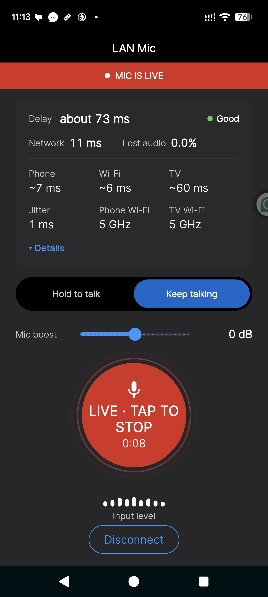
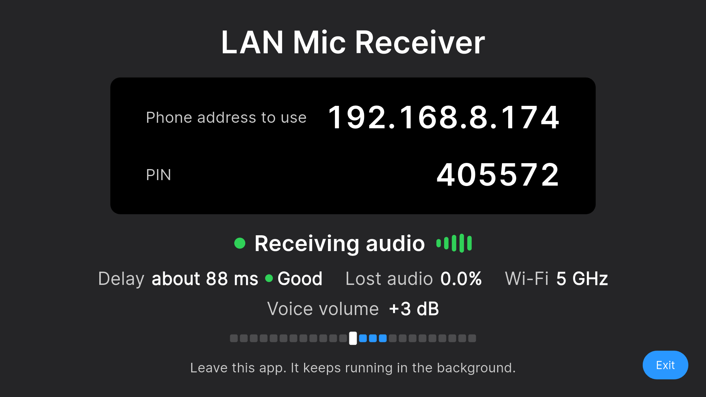
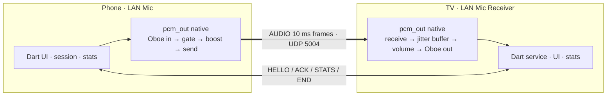

# LAN Mic

Use your Android phone as a live wireless microphone for your Android TV. Your voice goes over your home Wi‑Fi and plays on the TV in near real time. No cables, no Bluetooth, no extra hardware.

<table>
  <tr>
    <th>Phone: LAN Mic</th>
    <th>TV: LAN Mic Receiver</th>
  </tr>
  <tr>
    <td></td>
    <td></td>
  </tr>
</table>

## How it works

```
 phone mic ─▶ Oboe/AAudio capture ─▶ 10 ms frames, sent the moment they fill ─▶ UDP 5004
  (LAN Mic)        (C++)                       same Wi‑Fi network
 ─▶ adaptive jitter buffer ─▶ Oboe/AAudio output ─▶ TV speakers
         (C++)                (LAN Mic Receiver)
```

The TV shows its IP address and a 6‑digit PIN. Type both into the phone, tap **Connect**, and talk.

Audio never passes through Dart: on both ends it runs in native code (Oboe, low‑latency/MMAP where the device allows). Measured on a Pixel 7 → Chromecast with Google TV: **about 70–80 ms mouth‑to‑TV‑output delay, under 0.5% lost audio** (HDMI and the TV's own sound processing come on top).

## Architecture



Component diagram, connect/talk sequence, phone and TV audio pipelines and the delay budget: [docs/architecture.md](docs/architecture.md).

## Features

**Phone**
- **Hold to talk** (push‑to‑talk) or **Keep talking** (mic stays on).
- Clear status: Not connected, Connected, No response, Lost.
- Keeps working with the screen locked or while you're in another app. A phone call pauses the mic, and it stays paused until you tap again.
- A noise gate mutes the mic between phrases, which cuts echo from the TV speakers.
- Reconnects on its own after another app (for example the camera) takes the mic.
- **Connection stats:** Delay with a Good / OK / Slow word, Network round trip, Lost audio, and a Details breakdown (phone, Wi‑Fi, TV, jitter, both Wi‑Fi bands).
- **Mic boost:** −12 to +12 dB slider for a quiet mic; a soft limiter stops loud singing from distorting ("Too loud, limiting").
- Native low‑latency capture (Oboe/AAudio) with a measured phone delay, and a low‑latency Wi‑Fi lock while connected.

**TV**
- Runs in the background and starts automatically when the TV boots.
- Shows the address and PIN to enter on the phone.
- Native low‑delay playback: an adaptive jitter buffer (10–40 ms) feeding an Oboe/AAudio output stream.
- Stats line under the status: Delay, Lost audio, Wi‑Fi band.
- **Voice volume:** D‑pad Up/Down sets your voice from −12 to +12 dB against the TV's other audio; OK resets to 0. The remote's own volume keys still control the whole TV.
- **Exit** stops the receiver completely. Home or Back leaves it running.

## Requirements

- Phone: Android 8.0 (API 26) or newer.
- TV: Android TV / Google TV, Android 7.0 (API 24) or newer.
- Both on the **same Wi‑Fi network**. Guest networks with client isolation block device‑to‑device traffic.

Tested on a Pixel 7 with a Chromecast with Google TV: a steady 100 frames/s, about 70–80 ms delay, under 0.5% lost audio.

## Install

1. Download the two APKs from [Releases](https://github.com/namila007/LanMic-Android/releases).
2. Phone: open the APK and allow installing from your browser or file manager.
3. TV: sideload with adb (Developer options → Wireless debugging), then install:

   ```bash
   adb connect <tv-ip>:<port>
   adb install lanmic-tv.apk
   ```

## Use

1. Open **LAN Mic Receiver** on the TV. Note the address and PIN.
2. Open **LAN Mic** on the phone, enter the address and PIN, then tap **Connect**.
3. Hold the mic button to talk, or switch to **Keep talking** to leave the mic on.

**Less echo:** hold the phone close to your mouth (bottom edge, 2–5 cm), point it away from the TV speakers, and keep the TV volume moderate.

## Build from source

Needs the Flutter SDK. Each package is separate, so run commands inside it.

```bash
cd protocol && dart test
cd phone && flutter test && flutter build apk --release
cd tv && flutter test && flutter build apk --release
pcm_out/tool/test_native.sh   # host C++ tests for the native audio (ASan/UBSan + TSan), needs clang++
```

| Folder | What it is |
|---|---|
| `phone/` | Phone sender app (`me.namila.app.lanmic`) |
| `tv/` | Android TV receiver app (`me.namila.app.lanmic.tv`) |
| `pcm_out/` | Shared native audio plugin (C++ Oboe capture + playback, jitter buffer, gain; Kotlin UDP socket) |
| `wifi_band/` | Small local plugin: reads the Wi‑Fi band, holds the low‑latency Wi‑Fi lock |
| `protocol/` | Shared Dart packet codec used by both apps |

**Wire protocol:** UDP on port 5004, little‑endian, with a 12‑byte header (magic `0x4D54`, version 1, type, seq, PIN) followed by the payload.
- **Types:** `AUDIO` (960 B = 10 ms of 48 kHz mono PCM16), `HELLO` (also the heartbeat; optional 4‑byte payload with the phone's RTT and total delay), `ACK`, `END`, `REJECT`, `STATS` (TV → phone once a second: TV delay, lost audio, jitter, and its Wi‑Fi band in the first few).
- **Rules:** the TV drops packets with a bad PIN, and plays audio only from the last phone that sent a valid `HELLO`.

## Known limitations

- The PIN stops accidental connections, but it isn't encryption. Use the app only on a home network you trust.
- Release APKs are signed with a debug key. They're for sideloading, not Google Play.
- Android only; there is no iOS app.
