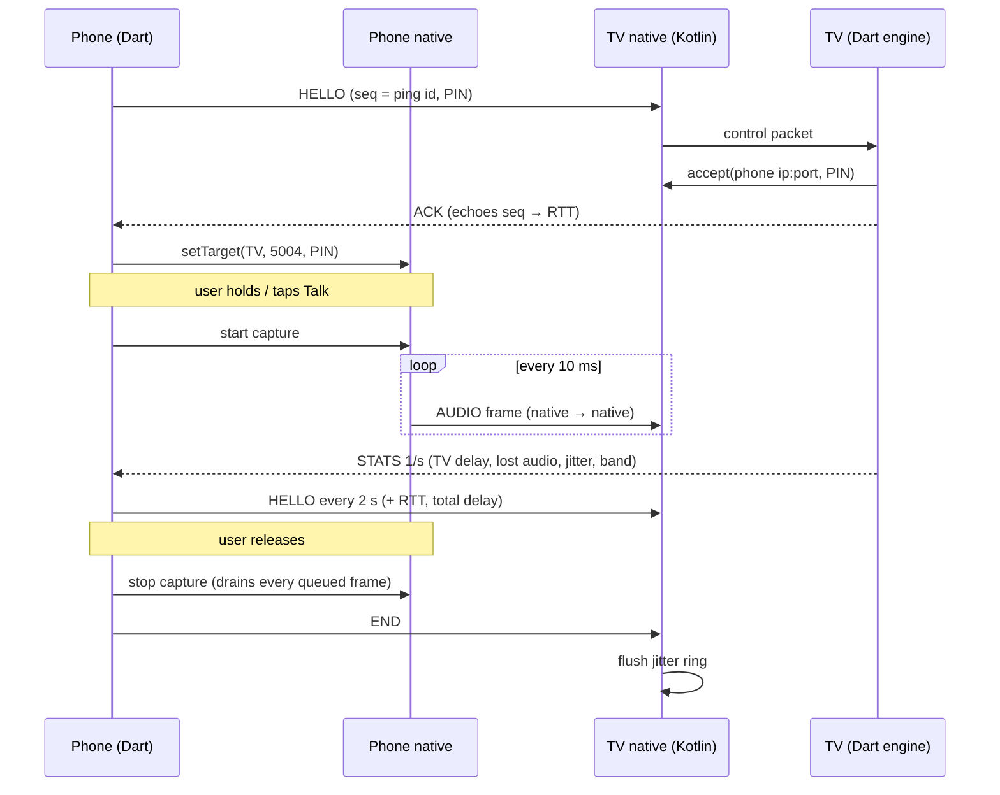
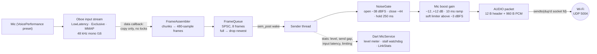
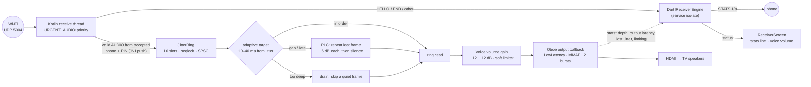
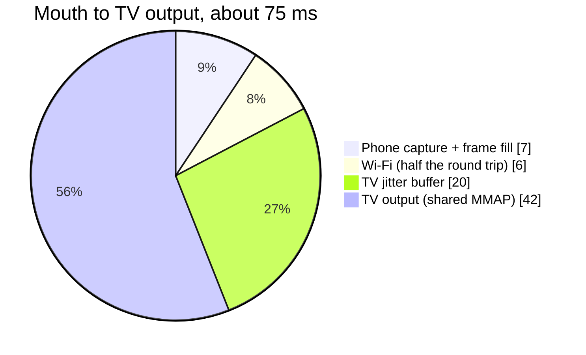

# LAN Mic architecture

Two Flutter apps share one native audio plugin. Dart handles the screens, connection state and stats. Audio frames never pass through Dart: they move between the microphone, the network and the speaker entirely in C++ and Kotlin.

## High-level components

```mermaid
flowchart LR
    subgraph Phone["Phone app · LAN Mic (me.namila.app.lanmic)"]
        direction TB
        PUI["MicScreen · StatsCard · Mic boost row"]
        PVM["MicViewModel · TalkGate"]
        PSES["SessionService · ConnectionMachine · LinkStats"]
        PMIC["MicService (native capture, level, stats poll)"]
        subgraph PPlug["pcm_out plugin (shared)"]
            PK["Kotlin NativeReceiver<br/>UDP socket on an ephemeral port"]
            PC["C++ AudioIn<br/>Oboe input · FrameQueue · NoiseGate · Gain · sender thread"]
        end
        PWB["wifi_band plugin<br/>Wi-Fi band · low-latency lock"]
        PUI --> PVM --> PSES
        PVM --> PMIC --> PC
        PSES -- "HELLO / END · targets" --> PK
        PK -- "socket fd" --> PC
        PVM --> PWB
    end

    subgraph TV["TV app · LAN Mic Receiver (me.namila.app.lanmic.tv)"]
        direction TB
        TUI["ReceiverScreen · stats line · Voice volume"]
        TVM["ReceiverViewModel"]
        subgraph SVC["Foreground service isolate (starts on boot)"]
            TENG["ReceiverEngine · SessionRegistry · LossMeter"]
        end
        subgraph TPlug["pcm_out plugin (shared)"]
            TK["Kotlin NativeReceiver<br/>UDP 5004 · validates AUDIO"]
            TC["C++ JitterRing → AudioOut<br/>Oboe output · Gain"]
        end
        TWB["wifi_band plugin"]
        TUI --> TVM
        TENG -- "status 4×/s" --> TVM
        TENG -- "accept(phone, pin) · STATS · ACK" --> TK
        TK -- "AUDIO frames (JNI)" --> TC
        TC -- "stats" --> TENG
        TENG --> TWB
    end

    PC == "AUDIO · 972 B every 10 ms<br/>UDP 5004 · DSCP EF" ==> TK
    PK -- "HELLO (+RTT, delay) · END" --> TK
    TK -- "ACK / REJECT · STATS 1/s" --> PK
```

| Component | Role |
|---|---|
| `protocol/` | Pure Dart packet codec: 12-byte header and types `AUDIO`, `HELLO`, `ACK`, `END`, `REJECT`, `STATS`; plus the Good/OK/Slow rule |
| `pcm_out/` | Shared native plugin. C++: Oboe input and output, `JitterRing`, `FrameQueue`, `NoiseGate`, voice gain and limiter. Kotlin: the UDP socket and JNI bridge |
| `wifi_band/` | Reads the Wi-Fi band and holds a low-latency Wi-Fi lock |
| Phone `SessionService` | Connection state (HELLO every 2 s), round-trip time, STATS intake, and the native send target |
| TV `ReceiverEngine` | PIN check, "last valid HELLO wins", ACK/REJECT, STATS once a second, and the stats shown on screen |

## Connect and talk

## Phone audio path

- Frames leave the moment they fill, no more than about 10 ms apart. The `record` plugin used to hand over audio in clumps.
- `stopCapture` is synchronous: it drains the queue before Dart sends `END`, so END never overtakes the last frame.

## TV audio path

- The output stream opens on the first frame of a burst and closes after 10 s of quiet. It reopens itself after an HDMI or route change.
- An empty buffer holds the current frame instead of skipping it, so a frame that arrives a few ms late still plays. Playback then runs one frame later.

## Where the delay goes (Pixel 7 → Chromecast with Google TV, 5 GHz)

HDMI and the TV's own sound processing come after this and aren't measured by the app.
